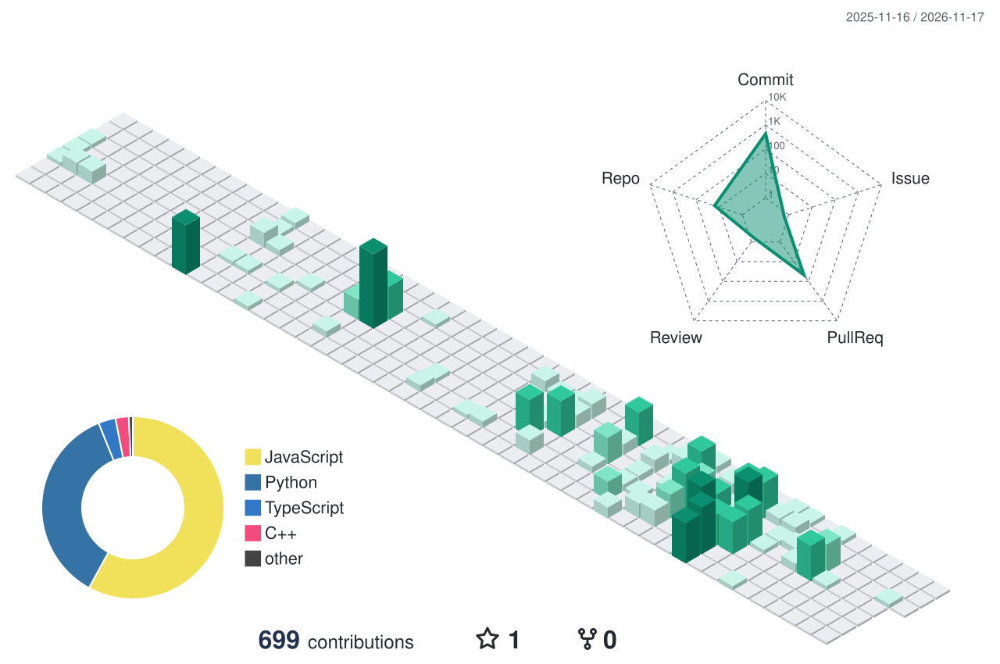

<h1 align="center">공세민 · Se Min Kong</h1>

로봇 센서와 3D 인터랙션을 개발합니다.

  
  

  <a href="https://seminkong.github.io/SeMinKong_Web/">포트폴리오</a> ·
  <a href="https://seminkong.github.io/SeMinKong_Web/resume/">이력서</a> ·
  <a href="mailto:semin1224@gmail.com">이메일</a>

  
실제 프로젝트 화면

  <table>
    <tr>
      <td width="50%" valign="top"> Tac-Touch · 모의 촉각 입력</td>
      <td width="50%" valign="top"> Bondi · VR 전시실</td>
    </tr>
  </table>

## 프로젝트

| 프로젝트 | 작업 내용 |
| :--- | :--- |
| [Tac-Touch](https://seminkong.github.io/SeMinKong_Web/work/tac-touch/) | SSAFY 자율 · 그리퍼 센서 펌웨어와 PC 앱의 3D 기구 편집 도구(MCP) 연동 |
| [Bondi · 본디](https://seminkong.github.io/SeMinKong_Web/work/bondi/) | SSAFY 특화 · 빗살무늬토기 3D 복원 실험, VR 전시실 제작과 손 조작 구현 |
| [THING](https://seminkong.github.io/SeMinKong_Web/work/thing/) | 손동작을 따라 움직이는 7축 텐던 로봇 핸드 |
| [AQIS](https://seminkong.github.io/SeMinKong_Web/work/aqis/) | 카메라로 제품을 검사하고 로봇팔로 분류하는 스마트 팩토리 |
| [Brain Tumor MRI](https://seminkong.github.io/SeMinKong_Web/work/brain-tumor-mri/) | YOLO11 종양 분류·분할과 폴리곤 전처리 |
| [Alkkagi.io](https://seminkong.github.io/SeMinKong_Web/work/alkkagi/) | 서버가 충돌과 마찰을 판정하는 실시간 멀티플레이 알까기 |
| [Project Prompt Generator](https://seminkong.github.io/SeMinKong_Web/work/project-prompt-generator/) | LangGraph 기반의 설계 대화와 구현 문서 생성 |
| [Briefit](https://seminkong.github.io/SeMinKong_Web/work/briefit/) | 뉴스 군집화와 KoBART 요약 |
| [Snake DQN](https://github.com/SeMinKong/Snake_DQN) | 상태 표현에 따른 DQN 성능 비교 |
| [TSP](https://github.com/SeMinKong/TSP) | PyTorch 기반 유전 알고리즘과 simulated annealing |

## 기술 스택

| 분야 | 사용한 기술 |
| :--- | :--- |
| 센서 수집과 로봇 제어 | C++, MCU 펌웨어, ROS 2, MCP |
| 3D 복원과 VR | TRELLIS, AdaPoinTr, Blender, Unreal Engine, OpenXR |
| AI와 컴퓨터 비전 | Python, PyTorch, YOLO, OpenCV |
| 로봇 시뮬레이션 | Isaac Sim, Isaac Lab |
| LLM과 백엔드 | FastAPI, LangChain, Ollama, llama.cpp, vLLM |
| 개발 환경과 협업 | Ubuntu, Docker, Git, Jira |

## 수상

  
  
  
  
  
  

## 이력

- 2026–현재 · SSAFY Robotics Track 15기
- 2020–2026 · 숭실대학교 소프트웨어학부, AI·빅데이터 융합전공

## GitHub 기록

  

